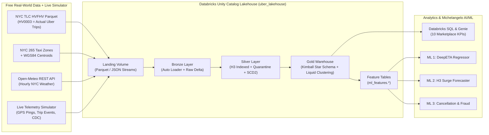

# Uber End-to-End Data Engineering, Real-Time Streaming, Lakehouse Warehouse & Michelangelo ML Platform on Databricks

An enterprise-grade, end-to-end simulation of **Uber's Generation-3 Kappa+ & Lakehouse Data Architecture**, built natively for **Databricks** in **PySpark, Python, Delta Lake, Structured Streaming, Lakeflow (DLT), Databricks SQL, and MLflow** — powered by **100% free, real-world public datasets** (actual NYC Uber `HV0003` trip records, NYC Taxi Zones, and Open-Meteo historical weather) plus a **real-time telemetry & CDC event simulator**.

---

## What This Repository Covers End-to-End

| Pillar | What Is Implemented in Detail | Key Files |
| :--- | :--- | :--- |
| **1. Complete Architecture** | Evolution of Uber's data stack (Kafka, Marmaray, Apache Hudi, Flink, Pinot, H3, Michelangelo) mapped 1:1 to Databricks Lakehouse | [`docs/01_architecture_deep_dive.md`](docs/01_architecture_deep_dive.md) |
| **2. Tools & Tech Stack** | Unity Catalog, Volumes, Delta Lake, Liquid Clustering, Auto Loader, Structured Streaming, Lakeflow/DLT, Photon SQL, MLflow, Asset Bundles | [`docs/02_tools_and_technologies.md`](docs/02_tools_and_technologies.md) |
| **3. Data Modeling** | Conceptual, Logical, & Physical ERDs; Kimball Star Schema (`fact_trips`, `fact_hex_supply_demand_5m`, `fact_driver_daily_summary`); **SCD Type 2** (`dim_driver_scd2`, `dim_rider_scd2`); **Uber H3** spatial modeling | [`docs/03_data_modeling.md`](docs/03_data_modeling.md), [`sql/01_ddl_gold_star_schema.sql`](sql/01_ddl_gold_star_schema.sql) |
| **4. Real-Time Ingestion & Streaming** | Live micro-batch simulator replaying real NYC Uber trips into GPS telemetry pings, trip state transitions, and Debezium-style CDC; ingested via **Auto Loader (`cloudFiles`)**, **10-min event-time watermarking**, **bounded deduplication**, and `foreachBatch` Delta `MERGE` | [`docs/04_realtime_ingestion_and_streaming.md`](docs/04_realtime_ingestion_and_streaming.md), [`notebooks/02_realtime_event_simulator_and_streaming.py`](notebooks/02_realtime_event_simulator_and_streaming.py) |
| **5. Transformations & Data Quality** | Medallion (Bronze $\rightarrow$ Silver $\rightarrow$ Gold), 7 Data Quality rules with **Quarantine Dead-Letter Table** (`silver.trips_quarantine`), H3 Resolution 7 & 8 indexing, two-sided marketplace take-rate & surge equations, **Lakeflow / DLT `@dlt.expect` pipeline** | [`docs/05_transformations_and_data_quality.md`](docs/05_transformations_and_data_quality.md), [`notebooks/03_silver_cleansing_geospatial_scd2.py`](notebooks/03_silver_cleansing_geospatial_scd2.py), [`pipelines/dlt_uber_medallion_pipeline.py`](pipelines/dlt_uber_medallion_pipeline.py) |
| **6. Data Warehousing & BI** | Gold Star Schema with **Liquid Clustering**, PK/FK optimizer constraints, AI/BI Genie semantic comments, and **10 Executive Marketplace SQL Analytics Queries** | [`docs/06_data_warehousing_and_bi.md`](docs/06_data_warehousing_and_bi.md), [`notebooks/04_gold_dimensional_warehouse.py`](notebooks/04_gold_dimensional_warehouse.py), [`sql/02_analytical_warehouse_queries.sql`](sql/02_analytical_warehouse_queries.sql) |
| **7. AI / ML Use Cases (Michelangelo)** | **3 Production ML Pipelines** tracked in **MLflow**: (1) **DeepETA** Travel Time `GBTRegressor`, (2) **H3 Dynamic Surge Multiplier Forecaster**, (3) **Cancellation Risk `GBTClassifier` & Long-Hauling Fraud Detector** | [`docs/07_ai_ml_use_cases.md`](docs/07_ai_ml_use_cases.md), [`notebooks/05_ml_eta_prediction.py`](notebooks/05_ml_eta_prediction.py), [`notebooks/06_ml_surge_pricing_forecast.py`](notebooks/06_ml_surge_pricing_forecast.py), [`notebooks/07_ml_cancellation_and_fraud.py`](notebooks/07_ml_cancellation_and_fraud.py) |
| **8. Databricks Deployment** | Works on **Databricks Free Edition, Serverless, and Enterprise**; includes 1-click runner notebook + **Databricks Asset Bundle (`databricks.yml`)** | [`docs/08_databricks_execution_guide.md`](docs/08_databricks_execution_guide.md), [`databricks.yml`](databricks.yml), [`notebooks/08_end_to_end_runner.py`](notebooks/08_end_to_end_runner.py) |

---

## High-Level Architecture



---

## Repository Structure

```text
Uber/
├── README.md                                          # Project overview & quickstart
├── databricks.yml                                     # Databricks Asset Bundle (Workflows + DLT IaC)
├── pyproject.toml                                     # Python package & dependency config
├── requirements.txt                                   # Optional runtime packages
├── Makefile                                           # Local testing, linting & bundle commands
├── docs/
│   ├── 01_architecture_deep_dive.md                   # Uber Gen1->Gen3 evolution & Databricks mapping
│   ├── 02_tools_and_technologies.md                   # Tech choices, public data specs, Photon/Delta tuning
│   ├── 03_data_modeling.md                            # ERDs, Star Schema, Fact grains, SCD Type 2
│   ├── 04_realtime_ingestion_and_streaming.md         # Auto Loader, Watermarks, Dedup, CDC & Simulator
│   ├── 05_transformations_and_data_quality.md         # Financial formulas, H3 indexing, DQ Quarantine
│   ├── 06_data_warehousing_and_bi.md                  # Liquid Clustering, AI/BI Genie & KPI catalog
│   ├── 07_ai_ml_use_cases.md                          # ETA, Surge Forecasting & Fraud ML architecture
│   └── 08_databricks_execution_guide.md               # Step-by-step guide to run in Databricks
├── src/
│   └── uber_platform/
│       ├── __init__.py
│       ├── config.py                                  # Auto-detects Unity Catalog vs Hive Metastore
│       ├── schemas.py                                 # Explicit PySpark StructTypes for all datasets
│       ├── geospatial.py                              # Uber H3 Res-7/8 indexing, NYC centroids, Haversine
│       ├── data_ingestion.py                          # Downloads real NYC Uber Parquet, Zones & Weather
│       ├── realtime_simulator.py                      # Generates streaming GPS pings, Trip events & CDC
│       ├── transformations.py                         # Reusable Silver/Gold PySpark transforms & SCD2 MERGE
│       └── ml_utils.py                                # Cyclical features, evaluation metrics & MLflow utils
├── notebooks/
│   ├── 00_setup_and_config.py                         # Initializes Catalog, Schemas & Landing Volume
│   ├── 01_public_data_ingestion_bronze.py             # Public data download -> Bronze Delta tables
│   ├── 02_realtime_event_simulator_and_streaming.py   # Live streaming ingestion + Watermark + H3 5m windows
│   ├── 03_silver_cleansing_geospatial_scd2.py         # DQ Quarantine, Uber H3 enrichment & SCD Type 2
│   ├── 04_gold_dimensional_warehouse.py               # Builds Star Schema dimensions & clustered fact tables
│   ├── 05_ml_eta_prediction.py                        # Michelangelo ML #1: DeepETA GBTRegressor + MLflow
│   ├── 06_ml_surge_pricing_forecast.py                # Michelangelo ML #2: H3 Surge Multiplier Forecaster
│   ├── 07_ml_cancellation_and_fraud.py                # Michelangelo ML #3: Cancellation & Anomaly Detection
│   └── 08_end_to_end_runner.py                        # 1-Click Master Orchestrator Notebook
├── pipelines/
│   └── dlt_uber_medallion_pipeline.py                 # Declarative Lakeflow / Delta Live Tables pipeline
├── sql/
│   ├── 01_ddl_gold_star_schema.sql                    # Gold Warehouse DDL with PK/FK & Liquid Clustering
│   └── 02_analytical_warehouse_queries.sql            # 10 Analytical SQL queries for Databricks SQL
└── tests/
    └── test_uber_platform.py                          # Unit tests for geospatial H3, simulator & ingestion
```

---

## 3-Minute Quickstart in Databricks

1. **Import Repository**: In Databricks Workspace, go to **Workspace $\rightarrow$ Create $\rightarrow$ Git folder** and clone this repository.
2. **Run End-to-End**: Open **`notebooks/08_end_to_end_runner`** on **Serverless** (or any DBR 14.3+ cluster) and click **Run All** — OR run notebooks `00` through `07` one by one to inspect every Medallion table, streaming checkpoint, and MLflow experiment!
3. **Explore SQL Analytics**: Open [`sql/02_analytical_warehouse_queries.sql`](sql/02_analytical_warehouse_queries.sql) in the **Databricks SQL Editor** to analyze marketplace take-rate, H3 surge maps, and airport curb wait SLAs.

See [`docs/08_databricks_execution_guide.md`](docs/08_databricks_execution_guide.md) for full details on running Lakeflow/DLT and Databricks Asset Bundles (`databricks.yml`).
