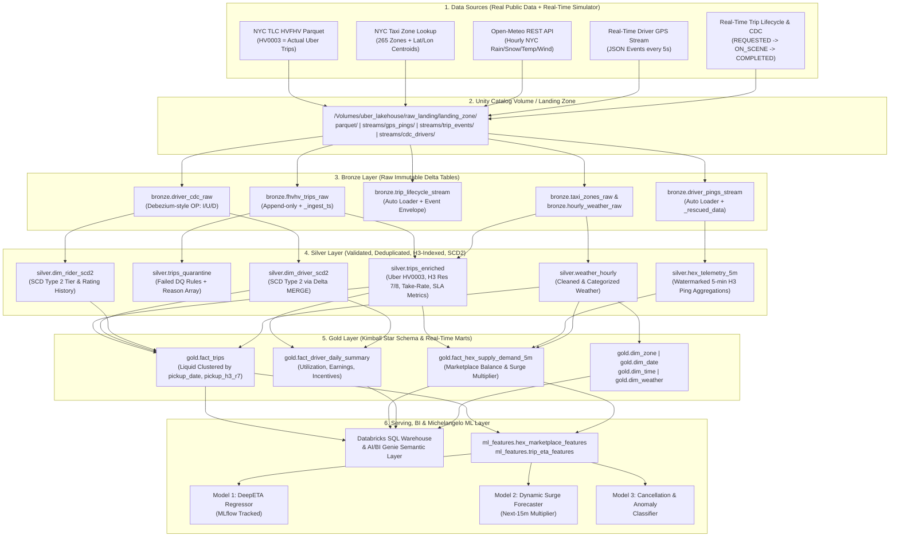

# 01. Architecture Deep Dive: Real-World Uber vs. Databricks Lakehouse Simulation

## 1. Executive Summary

Uber operates one of the largest real-time geospatial marketplaces in the world, processing **tens of millions of trips per day**, **billions of GPS telemetry pings**, and **petabytes of analytical and ML feature data**.

This project faithfully simulates **Uber's Generation-3 Kappa+ / Lakehouse Data Architecture** end-to-end inside **Databricks**, powered by **real NYC TLC High-Volume For-Hire Vehicle (`HV0003` = actual Uber trips)** data, **NYC Taxi Zone geospatial lookups**, **Open-Meteo hourly weather telemetry**, and a **real-time event stream simulator** producing live driver GPS pings, trip state transitions, and CDC profile mutations.

---

## 2. How Uber's Actual Data Platform Evolved

Understanding *why* Uber's architecture looks the way it does clarifies every design choice in this repository:

| Generation | Era | Uber Architecture | Bottlenecks Solved |
| :--- | :--- | :--- | :--- |
| **Gen 1** | 2010–2014 | Operational MySQL/PostgreSQL replicas + vertical ETL scripts into a monolithic OLAP warehouse | Could not scale past millions of daily trips; schema changes broke downstream ETL; zero real-time insights |
| **Gen 2** | 2015–2019 | **Marmaray** ingestion + **Kafka** + **HDFS/Parquet** -> **Apache Hudi** (invented at Uber for upserts/CDC on HDFS) + **Presto/Hive** | Solved mutable trip updates (late tips, fare adjustments, driver payouts, GDPR deletes) without rewriting entire partitions |
| **Gen 3 (Current)** | 2020–Present | **Kappa+ Unified Streaming & Lakehouse**: Kafka + Apache Flink + Transactional Table Format (Hudi/Delta) + Real-time OLAP (Apache Pinot) + **Uber H3** Hexagonal Indexing + **Michelangelo** ML Platform | Unified streaming and batch logic, sub-minute freshness for surge pricing, consistent online/offline ML features |

---

## 3. Component-by-Component Mapping: Uber Internal Stack vs. Databricks Lakehouse

| Architectural Layer | Uber Internal Technology | Databricks Lakehouse Equivalent (Used Here) | Role in This Project |
| :--- | :--- | :--- | :--- |
| **Operational Services** |Schemaless / DocStore / MySQL (Trip, Rider, Driver, Billing) | Simulated OLTP & CDC Producer (`realtime_simulator.py`) | Emits mutable rider/driver profile updates (`INSERT`/`UPDATE`) and transactional trip lifecycle events |
| **Event Bus / Streaming** | Apache Kafka + uReplicator | Landing JSON Streams + **Databricks Auto Loader (`cloudFiles`)** | Continuous micro-batch/streaming ingestion with schema inference, schema evolution, and `_rescued_data` |
| **Unified Ingestion** | **Marmaray** | `data_ingestion.py` + **Lakeflow / Delta Live Tables (DLT)** | Pulls batch Parquet (NYC TLC `HV0003` Uber), REST API JSON (Open-Meteo Weather), CSV lookups, and streaming telemetry |
| **Stream Processing** | Apache Flink / AthenaX | **PySpark Structured Streaming** (Stateful + Watermarks) | 5-minute tumbling/sliding H3 supply-demand windows, event-time watermarking, deduplication, stream-static joins |
| **Geospatial Indexing** | **Uber H3** (Hierarchical Hexagonal Index) | Databricks Native H3 / `h3-py` / Deterministic Hex Engine (`geospatial.py`) | Maps `(lat, lon)` to Resolution-7 (~5.16 km²) & Resolution-8 (~0.74 km²) hexagons for surge pricing and ETA |
| **Lakehouse Storage** | **Apache Hudi** on Cloud Object Storage | **Delta Lake** on Unity Catalog Managed Tables & Volumes | ACID transactions, `MERGE INTO` upserts for late fare/tip updates, Change Data Feed (CDF), Time Travel, Liquid Clustering |
| **Data Quality Gate** | Uber Data Quality Monitor (UDQ) | **DLT Expectations (`@dlt.expect`)** + Quarantine Table Pattern | Routes corrupt/invalid records (negative fares, impossible GPS coordinates, orphan durations) to `silver.quarantine_trips` |
| **Serving / OLAP** | Presto / Trino + Apache Pinot | **Databricks SQL Serverless Warehouse** (Photon Engine) | Sub-second Kimball Star Schema queries, marketplace KPIs, cohort retention, surge efficiency analytics |
| **ML & Feature Platform** | **Michelangelo** + Palette Feature Store | **Databricks MLflow** + Spark ML Pipelines + Feature Tables | End-to-end training, experiment tracking, evaluation, and batch/online-ready feature tables for ETA, Surge, and Fraud |
| **Governance & Catalog** | Databook | **Databricks Unity Catalog** (`uber_lakehouse.*.*`) | 3-level namespace isolation, column-level lineage, table/column semantic descriptions for AI/BI Genie |
| **Orchestration** | Peloton / Apache Airflow / Piper | **Databricks Workflows / Jobs** (`databricks.yml` Asset Bundle) | Multi-task DAG with dependencies, retries, and serverless compute orchestration |

---

## 4. End-to-End System Architecture Diagram

---

## 5. Key Architectural Design Decisions

### 5.1 Why Kappa+ / Medallion Instead of Pure Lambda?
In traditional **Lambda Architecture**, teams maintained two separate codebases: Java/Flink for streaming and Hive/Spark for batch, leading to logic drift between real-time surge dashboards and historical financial reporting.
In **Databricks Medallion + Structured Streaming**:
- The **exact same PySpark DataFrame transformation functions** (`src/uber_platform/transformations.py`) execute over bounded micro-batches (`trigger(availableNow=True)`) or continuous low-latency streams (`trigger(processingTime='10 seconds')`).
- Late-arriving trip adjustments (e.g., rider adds a tip 12 hours after dropoff, or toll reconciliation arrives next day) are handled idempotently via `DeltaTable.merge()` keyed on `trip_id`.

### 5.2 Why Hexagons (Uber H3) Instead of Rectangular Lat/Lon Grids or Boroughs?
Uber open-sourced **H3** because:
1. **Uniform neighbor distance**: Every hexagon has **6 neighbors whose centroids are equidistant** from the center hexagon. Squares have 4 edge neighbors (distance $1$) and 4 diagonal neighbors (distance $\sqrt{2} \approx 1.414$), distorting spatial smoothing and driver dispatch radii.
2. **Multi-resolution hierarchy**:
   - **H3 Resolution 7** (~5.16 km² area, ~1.22 km edge): Ideal for regional marketplace **Supply-Demand & Surge Pricing** smoothing without noisy zero-count cells.
   - **H3 Resolution 8** (~0.74 km² area, ~461 m edge): Ideal for **street-level pickup ETA** and **driver dispatch matching**.

### 5.3 Unity Catalog + Fallback Portability
Modern Databricks workspaces (including **Databricks Free Edition**, **Serverless**, and **Enterprise**) enforce **Unity Catalog** (`<catalog>.<schema>.<table>` and `/Volumes/<catalog>/<schema>/<volume>`). Legacy Community clusters use `spark_catalog` + `dbfs:/tmp/`.
`src/uber_platform/config.py` inspects the active runtime and seamlessly configures **3-level Unity Catalog namespaces + Managed Volumes** first, automatically falling back to `spark_catalog` if Unity Catalog is unavailable.
