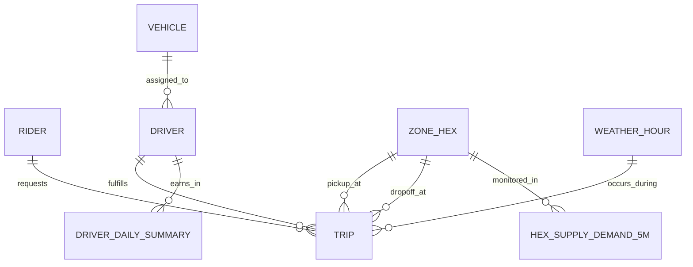

# 03. Data Modeling: Conceptual, Logical & Physical Lakehouse Design

## 1. Modeling Philosophy

At Uber scale, a single modeling paradigm is not enough. We combine **three complementary modeling techniques across the Medallion layers**:

1. **Bronze Layer — Schema-on-Write + Semi-Structured Envelope**: Exact fidelity to source systems (`_ingest_ts`, `_source_file`, `_rescued_data`) for replayability and auditability.
2. **Silver Layer — Normalized 3NF / Anchor Entities + SCD Type 2 + Geospatial Enrichment**: Deduplicated enterprise entities (`trips_enriched`, `dim_driver_scd2`, `dim_rider_scd2`, `hex_telemetry_5m`) serving as the single source of truth.
3. **Gold Layer — Kimball Dimensional Star Schema + Periodic Marketplace Snapshots**: Optimized for BI tools, Databricks SQL Photon vectorized joins, AI/BI Genie natural language queries, and ML Feature Store joins.

---

## 2. Conceptual Data Model

---

## 3. Gold Layer Kimball Star Schema (Physical ERD)

```mermaid
erDiagram
    fact_trips {
        string trip_id PK "Deterministic SHA256 surrogate key"
        bigint driver_sk FK "Points to dim_driver_scd2"
        bigint rider_sk FK "Points to dim_rider_scd2"
        int pickup_date_key FK "YYYYMMDD -> dim_date"
        int pickup_time_key FK "HHMM -> dim_time"
        int pu_location_id FK "-> dim_zone"
        int do_location_id FK "-> dim_zone"
        string weather_hour_key FK "YYYYMMDDHH -> dim_weather"
        string pickup_h3_r7 "H3 Res-7 hexagon (~5.16 km2)"
        string pickup_h3_r8 "H3 Res-8 hexagon (~0.74 km2)"
        string dropoff_h3_r7 "H3 Res-7 hexagon"
        string product_type "UberX | UberX Share | UberWAV | UberXL | Comfort"
        timestamp request_ts "Rider tap timestamp"
        timestamp on_scene_ts "Driver curb arrival timestamp"
        timestamp pickup_ts "Trip start timestamp"
        timestamp dropoff_ts "Trip completion timestamp"
        double wait_time_sec "pickup_ts - request_ts"
        double driver_arrival_sec "on_scene_ts - request_ts"
        double curb_wait_sec "pickup_ts - on_scene_ts"
        double trip_duration_sec "dropoff_ts - pickup_ts"
        double trip_miles "Trip distance in miles"
        double avg_speed_mph "trip_miles / (trip_duration_sec / 3600)"
        double surge_multiplier "Dynamic marketplace surge factor (>=1.0)"
        double base_passenger_fare "Base rider fare USD"
        double tolls_amount "Bridge/tunnel tolls USD"
        double congestion_surcharge "NYC congestion fee USD"
        double airport_fee "JFK/LGA/EWR fee USD"
        double tips_amount "Rider tip USD"
        double taxes_and_fees "Sales tax + Black Car Fund USD"
        double total_rider_amount "Total charged to rider USD"
        double driver_pay_amount "Net payout to driver USD"
        double uber_gross_margin "Platform take before taxes/tolls USD"
        double take_rate_pct "uber_gross_margin / gross_bookings"
        boolean is_airport_trip "True if PU or DO is JFK/LGA/EWR"
        boolean is_shared_trip "True if UberX Share requested"
    }

    dim_driver_scd2 {
        bigint driver_sk PK "Surrogate key (monotonically generated)"
        string driver_id "Natural key (DRV-XXXXXX)"
        string home_borough "Driver primary operating borough"
        string vehicle_type "Sedan | SUV | EV | WAV"
        double driver_rating "Rolling 500-trip rating (1.0-5.0)"
        string driver_tier "Blue | Gold | Platinum | Diamond"
        boolean is_ev_vehicle "Green vehicle incentive eligibility"
        timestamp effective_start_ts "SCD2 validity start"
        timestamp effective_end_ts "SCD2 validity end (9999-12-31 if current)"
        boolean is_current "Active record flag"
    }

    dim_rider_scd2 {
        bigint rider_sk PK "Surrogate key"
        string rider_id "Natural key (RDR-XXXXXX)"
        string membership_status "None | Uber_One_Monthly | Uber_One_Annual"
        double rider_rating "Rider rating (1.0-5.0)"
        string preferred_payment "Card | ApplePay | UberCash | Corporate"
        timestamp effective_start_ts "SCD2 start"
        timestamp effective_end_ts "SCD2 end"
        boolean is_current "Active flag"
    }

    dim_zone {
        int location_id PK "NYC TLC LocationID (1..265)"
        string borough "Manhattan | Brooklyn | Queens | Bronx | EWR | Staten Island"
        string zone_name "Neighborhood / Airport name"
        string service_zone "Yellow Zone | Boro Zone | Airports | EWR"
        double centroid_lat "WGS84 centroid latitude"
        double centroid_lon "WGS84 centroid longitude"
        string centroid_h3_r7 "Primary H3 Res-7 index"
        string centroid_h3_r8 "Primary H3 Res-8 index"
        boolean is_airport "JFK, LaGuardia, or Newark"
    }

    dim_weather {
        string weather_hour_key PK "YYYYMMDDHH UTC"
        timestamp observation_hour_ts "Truncated hour timestamp"
        double temp_celsius "2m air temperature C"
        double precipitation_mm "Total liquid equivalent mm"
        double rain_mm "Rainfall mm"
        double snowfall_cm "Snowfall cm"
        double wind_speed_kmh "10m wind speed km/h"
        int weather_code "WMO weather condition code"
        string weather_condition "Clear | Cloudy | Rain | Heavy_Rain | Snow | Storm"
        boolean is_adverse_weather "True if Rain > 2mm or Snow > 0.5cm or Wind > 35km/h"
    }

    dim_date {
        int date_key PK "YYYYMMDD"
        date full_date "Calendar date"
        int year "Calendar year"
        int quarter "1..4"
        int month "1..12"
        string month_name "January..December"
        int day_of_week "1=Mon..7=Sun"
        string day_name "Monday..Sunday"
        boolean is_weekend "Sat or Sun"
        boolean is_us_holiday "Federal holiday indicator"
    }

    dim_time {
        int time_key PK "HHMM (0..2359)"
        int hour_24 "0..23"
        int minute "0..59"
        string time_of_day_bucket "Early_Morning | AM_Rush | Midday | PM_Rush | Evening | Late_Night"
        boolean is_rush_hour "AM (7-9) or PM (16-19) Rush"
    }

    fact_hex_supply_demand_5m {
        string window_hex_id PK "window_start + h3_r7"
        timestamp window_start_ts "5-min tumbling window start"
        timestamp window_end_ts "5-min tumbling window end"
        string h3_r7 "H3 Resolution-7 cell"
        int active_drivers_supply "Distinct idle/available drivers in hex"
        int ride_requests_demand "Trip requests originating in hex"
        int completed_pickups "Fulfilled pickups in window"
        int unfulfilled_requests "Cancelled / timed-out requests"
        double demand_supply_ratio "ride_requests_demand / max(active_drivers_supply, 1)"
        double recommended_surge_multiplier "Marketplace equilibrium surge (1.0x - 3.5x)"
        double avg_pickup_eta_sec "Mean driver_arrival_sec in hex"
        string weather_hour_key FK "-> dim_weather"
    }

    dim_driver_scd2 ||--o{ fact_trips : "driver_sk"
    dim_rider_scd2 ||--o{ fact_trips : "rider_sk"
    dim_zone ||--o{ fact_trips : "pu_location_id / do_location_id"
    dim_weather ||--o{ fact_trips : "weather_hour_key"
    dim_date ||--o{ fact_trips : "pickup_date_key"
    dim_time ||--o{ fact_trips : "pickup_time_key"
    dim_weather ||--o{ fact_hex_supply_demand_5m : "weather_hour_key"
```

---

## 4. Fact Table Types & Grain Definitions (Kimball Matrix)

| Fact Table | Kimball Fact Type | Exact Grain Definition | Update Pattern | Clustering Keys |
| :--- | :--- | :--- | :--- | :--- |
| `gold.fact_trips` | **Transaction + Accumulating Milestones** | One row per completed or reconciled Uber trip (`trip_id`) | Incremental `MERGE INTO` (supports late tip/toll adjustments) | `(pickup_date_key, pickup_h3_r7)` |
| `gold.fact_hex_supply_demand_5m` | **Periodic Snapshot Fact** | One row per **5-minute tumbling window** per **H3 Resolution-7 hexagon** | Streaming / micro-batch upsert keyed on `(window_start_ts, h3_r7)` | `(window_start_ts, h3_r7)` |
| `gold.fact_driver_daily_summary` | **Periodic Aggregate Fact** | One row per **driver (`driver_id`)** per **calendar date (`date_key`)** | Daily / micro-batch recomputation over changed dates | `(date_key, home_borough)` |

---

## 5. Slowly Changing Dimensions (SCD Type 2) Design

Why SCD Type 2 is mandatory for Uber's `dim_driver_scd2` and `dim_rider_scd2`:
- Suppose Driver `DRV-001042` upgrades from a gas **Sedan** (`Blue` tier) to an **Electric SUV** (`Platinum` tier) on January 18th, or a Rider subscribes to **Uber One** (`Uber_One_Monthly`) mid-month.
- If we overwrote the attribute in place (SCD Type 1), historical analysis of *"How much do Uber One members tip vs non-members?"* or *"EV trip share in early January"* would retroactively corrupt historical facts!
- With **SCD Type 2**:
  - Previous version is closed: `effective_end_ts = event_ts`, `is_current = false`
  - New version is inserted: `effective_start_ts = event_ts`, `effective_end_ts = '9999-12-31 23:59:59'`, `is_current = true`
  - `fact_trips` joins to `dim_driver_scd2` using range-join semantics:
    `f.driver_id = d.driver_id AND f.pickup_ts >= d.effective_start_ts AND f.pickup_ts < d.effective_end_ts`.
