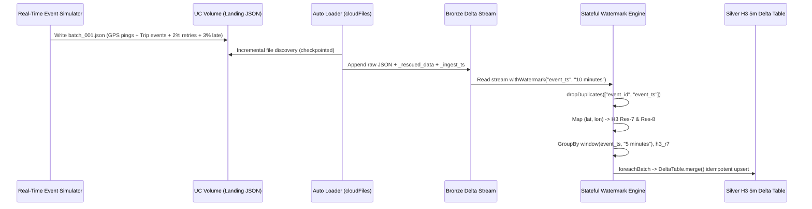

# 04. Real-Time Data Ingestion & Stateful Stream Processing

## 1. Uber's Real-Time Ingestion Challenge

In production at Uber, three high-velocity event streams power real-time dispatch, dynamic surge pricing, and safety monitoring:

1. **Driver GPS Telemetry Stream (`driver_pings`)**: Every online Uber driver's app emits `(driver_id, lat, lon, speed_mph, heading, status=[AVAILABLE|EN_ROUTE|ON_TRIP], battery_pct)` every **4–5 seconds**.
2. **Trip Lifecycle State Machine Stream (`trip_events`)**: Every ride transitions asynchronously through states:
   `REQUESTED -> DISPATCHED -> DRIVER_ON_SCENE -> IN_PROGRESS -> COMPLETED` (or `CANCELLED_BY_RIDER` / `CANCELLED_BY_DRIVER` / `NO_DRIVERS_AVAILABLE`).
3. **Database Change Data Capture (`cdc_driver_profiles`)**: Operational updates when a driver changes vehicle, rating updates, or tier upgrades (`op = 'c' | 'u' | 'd'`).

---

## 2. How We Simulate Real-Time Streams Faithfully in Databricks

Instead of generating random fake coordinates in the ocean, `src/uber_platform/realtime_simulator.py`:
1. Reads **actual NYC Uber trips** (`HV0003`) and **NYC Taxi Zone centroids**.
2. Replays those trips chronologically as realistic **micro-batch JSON files** dropped into Unity Catalog Volume `/Volumes/uber_lakehouse/raw_landing/landing_zone/streams/...`:
   - Interpolates multi-point GPS trajectories from pickup `(lat, lon)` to dropoff `(lat, lon)` for active drivers, plus idle roaming drivers around busy Manhattan/JFK/Brooklyn zones.
   - Injects realistic **real-world streaming anomalies** so you can test streaming resilience:
     - **Duplicate events** (~2% retry duplicates with identical `event_id` — simulating mobile network retries in NYC subway tunnels!)
     - **Out-of-order / late events** (~3% delayed by 1–8 minutes — simulating temporary cell dead zones)
     - **Corrupt / schema-drift payloads** (~0.5% malformed fields — caught by Auto Loader `_rescued_data` and Silver Quarantine!)

---

## 3. Streaming Architecture Sequence Diagram



---

## 4. Critical Streaming Patterns Implemented

### 4.1 Auto Loader (`cloudFiles`) with Schema Evolution & Rescue
When running on Databricks, our streaming reader automatically uses `spark.readStream.format("cloudFiles")` (with seamless fallback to standard `spark.readStream.format("json")` when running on local open-source PySpark):
```python
(
    spark.readStream
    .format("cloudFiles")
    .option("cloudFiles.format", "json")
    .option("cloudFiles.schemaLocation", f"{checkpoint_base}/schema_gps")
    .option("cloudFiles.inferColumnTypes", "true")
    .option("rescuedDataColumn", "_rescued_data")
    .load(gps_stream_landing_path)
)
```

### 4.2 Event-Time Watermarking + Bounded Deduplication
Mobile apps frequently retry sending telemetry when switching between Wi-Fi and 5G. Without state cleanup, `dropDuplicates(["event_id"])` would grow Spark executor memory infinitely until OOM!
By combining **watermarking** with event-time deduplication:
```python
deduped_stream = (
    raw_gps_stream
    .withWatermark("event_ts", "10 minutes")
    .dropDuplicates(["event_id", "event_ts"])
)
```
Spark automatically evicts state keys older than `max(event_ts) - 10 minutes`, keeping RocksDB / JVM state memory flat indefinitely.

### 4.3 `foreachBatch` + Idempotent `MERGE INTO`
Downstream Gold marketplace tables cannot have duplicate `(window_start_ts, h3_r7)` rows if a late event updates an already-emitted 5-minute window. Using `foreachBatch` with `DeltaTable.merge()` ensures **end-to-end exactly-once semantics** into `gold.fact_hex_supply_demand_5m`.
