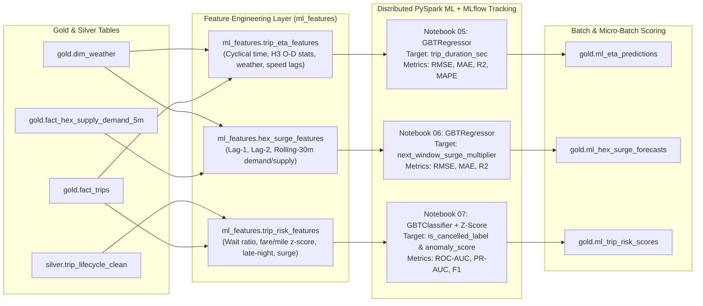

# 07. AI / ML Use Cases: Simulating Uber Michelangelo on Databricks

## 1. How Uber Uses AI/ML in Production

Uber's **Michelangelo** platform powers hundreds of real-time and batch ML models across the ride lifecycle:
1. **Before Rider Requests**: **Dynamic Surge Pricing & Supply Positioning** (predicting H3 hexagon demand 15 minutes ahead to reposition idle drivers and price marketplace equilibrium).
2. **At Ride Request Screen**: **DeepETA** (predicting exact travel duration `trip_duration_sec` and pickup arrival ETA before dispatching a driver).
3. **During Dispatch & Post-Trip**: **Cancellation Risk & Fraud/Anomaly Detection** (detecting high-cancellation-risk dispatches, GPS spoofing, or abnormal fare/distance manipulation).

In this repository, we implement **all three end-to-end in PySpark + MLflow**, backed by reusable **Feature Store tables** in `uber_lakehouse.ml_features`.

---

## 2. ML Architecture on Databricks

---

## 3. Detailed Breakdown of the 3 Implemented ML Notebooks

### Use Case 1: ETA Prediction (`notebooks/05_ml_eta_prediction.py`)
- **Inspiration**: Uber's **DeepETA** (hybrid spatial-temporal travel time estimation).
- **Target Variable**: `trip_duration_sec` (continuous seconds).
- **Engineered Features**:
  - **Geospatial**: `trip_miles`, Haversine straight-line distance (`haversine_miles`), route circuity ratio (`trip_miles / max(haversine_miles, 0.15)`), `pu_borough`, `do_borough`, `is_airport_num`, `same_borough_num`.
  - **Cyclical Temporal Encoding** (so hour `23` and hour `0` are adjacent in feature space):
    $$\text{hour\_sin} = \sin\left(\frac{2\pi \cdot \text{hour}}{24}\right), \quad \text{hour\_cos} = \cos\left(\frac{2\pi \cdot \text{hour}}{24}\right)$$
    $$\text{dow\_sin} = \sin\left(\frac{2\pi \cdot \text{day\_of\_week}}{7}\right), \quad \text{dow\_cos} = \cos\left(\frac{2\pi \cdot \text{day\_of\_week}}{7}\right)$$
  - **Historical Corridor Baseline (Leakage-Free)**: Historical average speed (`corridor_hist_speed_mph`) and `physics_baseline_eta_sec` per `(pickup_h3_r7, dropoff_h3_r7)` computed **strictly on the training split** so test target durations never leak into features.
  - **Weather Context**: `temp_celsius`, `precipitation_mm`, `wind_speed_kmh`, `is_adverse_weather_num`.
- **Model & Validation**:
  - Chronological out-of-time train/test split (first 80% of timestamps for training, final 20% for testing).
  - Distributed `pyspark.ml.Pipeline` (`StringIndexer` $\rightarrow$ `OneHotEncoder` $\rightarrow$ `VectorAssembler` $\rightarrow$ `GBTRegressor`).
  - Tracked in **MLflow** (`/Users/<user>/uber_michelangelo_eta_prediction`) with `RMSE`, `MAE`, `R2`, and `MAPE %`, writing predictions to `gold.ml_eta_predictions`.

---

### Use Case 2: Dynamic Surge Pricing & Demand Forecasting (`notebooks/06_ml_surge_pricing_forecast.py`)
- **Inspiration**: Uber Marketplace Spatio-Temporal Surge Forecasting & Proactive Driver Repositioning.
- **Target Variable**: `next_window_surge_multiplier` (and `next_window_demand`) per `h3_r7` cell ahead of time.
- **Engineered Features (`ml_features.hex_surge_features`)**:
  - **Autoregressive Spatio-Temporal Lags** per H3 Resolution-7 hexagon:
    - `demand_lag_1` (\(t - 5\text{m}\)), `demand_lag_2` (\(t - 10\text{m}\))
    - `rolling_avg_demand` (3-window rolling mean)
    - `demand_momentum` (\(\text{demand}_t - \text{demand}_{t-2}\))
    - `supply_lag_1`, `surge_lag_1`
  - **Current Marketplace Equilibrium**: `active_drivers_supply`, `ride_requests_demand`, `demand_supply_ratio`, `avg_pickup_eta_sec`.
  - **Contextual Signals**: Cyclical time-of-day, `is_weekend_num`, `precipitation_mm`, `wind_speed_kmh`, `is_adverse_weather_num`.
- **Business Output (`gold.ml_hex_surge_forecasts`)**:
  - Classifies each hexagon-window into actionable dispatch directives:
    - `HIGH_PRIORITY_DRIVER_INCENTIVE_ALERT` (`forecasted_surge_multiplier >= 1.6`)
    - `NUDGE_NEARBY_IDLE_DRIVERS` (`forecasted_surge_multiplier >= 1.25`)
    - `BALANCED_NO_ACTION` (`< 1.25`)

---

### Use Case 3: Cancellation Risk & Fraud/Fare Anomaly Detection (`notebooks/07_ml_cancellation_and_fraud.py`)
- **Inspiration**: Uber **Mastermind** & **RADAR** (Real-time Anomaly Detection & Risk).
- **Dual-Stage Architecture**:
  1. **Part A — Supervised Cancellation Risk Classifier (`GBTClassifier`)**:
     - Predicts the probability (`cancel_risk_prob`) that a requested ride cancels prior to pickup based on `driver_arrival_sec`, `surge_multiplier`, `is_shared_num`, `is_airport_num`, `base_passenger_fare`, and adverse weather.
     - Logged to **MLflow** (`/Users/<user>/uber_michelangelo_risk_and_fraud`) with `ROC-AUC`, `PR-AUC`, `F1`, and `Accuracy`.
  2. **Part B — Unsupervised Driver Long-Hauling & Fare/GPS Anomaly Scoring**:
     - Computes product-normalized Z-scores across completed trips:
       - `circuity_zscore`: Flags abnormal route detours (`trip_miles / haversine_miles` $> 3.0\sigma$ for trips $>3$ miles $\rightarrow$ `SUSPECTED_DRIVER_LONG_HAULING`).
       - `fare_per_mile_zscore`: Flags abnormal fare spikes ($> 3.5\sigma$ $\rightarrow$ `ABNORMAL_FARE_SPIKE`).
       - Velocity check: Flags physically implausible urban speeds ($> 78\text{ mph}$ $\rightarrow$ `GPS_VELOCITY_ANOMALY`).
     - Writes unified risk flags and probabilities to `gold.ml_trip_risk_scores` for Trust & Safety review and SQL KPI #10.

---

## 4. Extending to Databricks AI/BI Genie & Mosaic AI Model Serving

Because every Gold and ML output table is registered in **Unity Catalog** with rich business column comments (`sql/01_ddl_gold_star_schema.sql`):
1. **Databricks AI/BI Genie**: Point a Genie Space at `uber_lakehouse.gold` (`fact_trips`, `fact_hex_supply_demand_5m`, `ml_eta_predictions`, `ml_hex_surge_forecasts`, `ml_trip_risk_scores`, and dimensions) to ask natural-language questions directly over both historical facts and ML predictions.
2. **Mosaic AI Model Serving**: Any MLflow run logged by Notebooks `05`, `06`, or `07` can be registered to Unity Catalog (`mlflow.register_model("runs:/<run_id>/model", "uber_lakehouse.ml_features.deep_eta_model")`) and deployed behind a REST endpoint for sub-100ms online inference.
